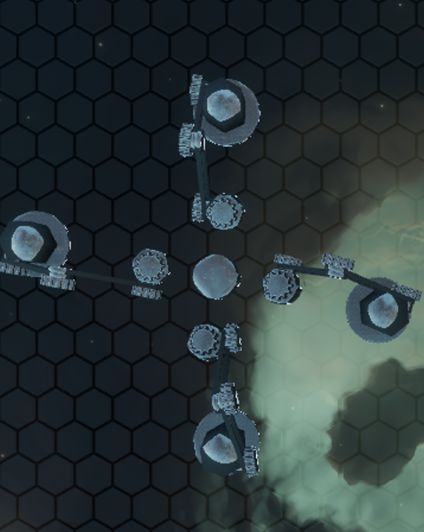

Initial prompt on Walker gather/scatter RequestBeacons:

I'd like to add a new RequestBeacon type, it will be very similar to the behavior of Pickup/Dropoff beacons. We could call it PickupSingles (unless you can think of something more clever.) This variation of the pick up beacon will be placed with a selected orb type as well a cyclable radius of influence. Walkers will pick up single orbs (orbs with no bonds) in the set radius of the beacon that match the orb type selected for the placed beacon. Allow Walkers to pick up up to 10 orbs individually in one foot. The DropoffSingles beacon should also have a radius. The walker should place each orb its holding individually on separate tiles within the radius of the drop off beacon.

Notes:
- Walkers should pick up all orbs available in the gather radius (up to its holding capacity), than proceed to delivery at the dropoff radius.
- If no more orbs are available in the gather radius, the walker should return to the dropoff radius and place each orb its holding individually on separate tiles within the radius of the drop off beacon.
- 

noteworthy prompts:
Walkers should move to the Gather beacon until an orb enters one of its legs quadrant boundaries. they should than assign a foot to pick up. They should than continue use the same foot to pick up other orbs available. All of this should should happen without any violation of basic foot assignment behavior. If an orb after the first isn't in the quadrant of the foot assigned to holding, it should influence its leg quadrant orientation to align the holding quadrant with the desired orb for pick up. I believe standard pick up logic correctly handles pivoting. We need to retain realism (previous language models try to resolve this with immediate foot location updates)